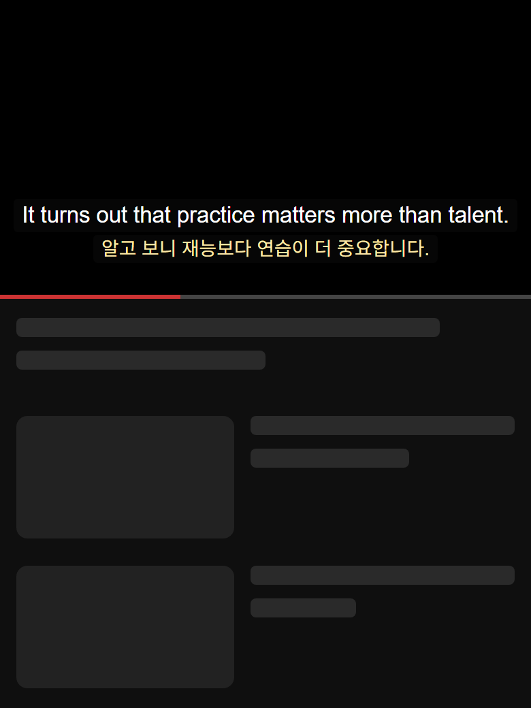
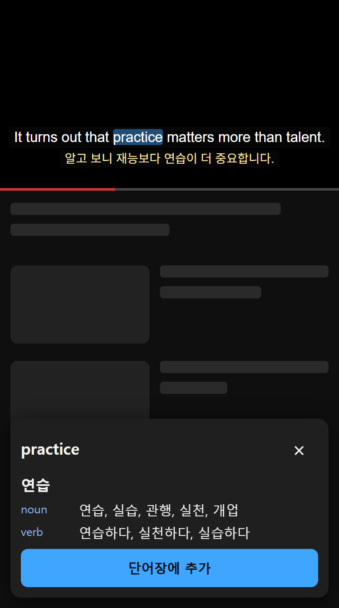
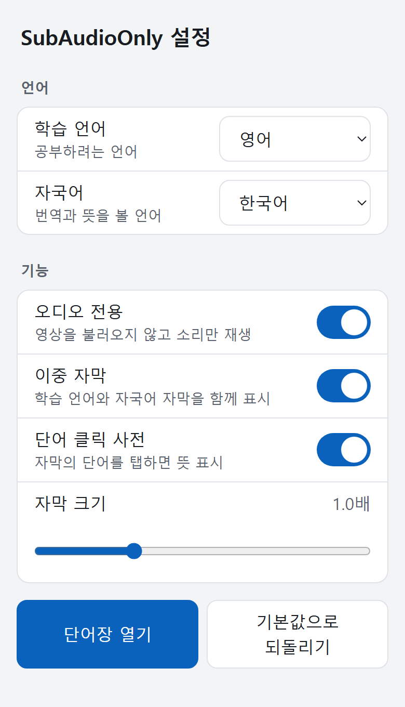

# SubAudioOnly

팟캐스트처럼 YouTube를 들으며 외국어를 공부하기 위한 Firefox(Android) 익스텐션입니다.

- **오디오 전용 재생** — 영상은 불러오지 않고 소리만 재생합니다. 화면에는 검은 배경과 자막만 남습니다.
- **이중 자막** — 학습 언어와 자국어 자막을 함께 보여 줍니다. 한쪽 자막만 있으면 YouTube 자동번역으로 채웁니다.
- **단어 사전** — 자막의 단어를 탭하면 자국어 뜻이 나옵니다.
- **단어장** — 찾아본 단어를 저장하고, 마크다운 표로 복사해 노션 등에 붙여넣을 수 있습니다.

| 이중 자막 | 사전 | 설정 | 단어장 |
| --- | --- | --- | --- |
|  |  |  |  |

## 상태

아직 실제 기기에서 검증하지 못한 초기 버전입니다. 단위 테스트와 린트만 통과한 상태이고, YouTube 쪽 변경에 따라 오디오 전용 재생이나 자막 로딩이 동작하지 않을 수 있습니다.

## 설치 (개발용)

Firefox 125 이상이 필요합니다.

```sh
# 데스크톱 Firefox에서 실행
npx web-ext run -s extension

# Android (USB 디버깅 + Firefox Nightly)
npx web-ext run -s extension --target=firefox-android --android-device=<기기 ID>
```

## 설정

툴바 버튼에서 기능을 켜고 끌 수 있고, 설정 페이지에서 아래 항목을 바꿀 수 있습니다.

| 항목 | 기본값 |
| --- | --- |
| 학습 언어 | 영어 |
| 자국어 | 한국어 |
| 오디오 전용 | 켜짐 |
| 이중 자막 | 켜짐 |
| 단어 클릭 사전 | 켜짐 |
| 자막 크기 | 1.0배 |

## 개발

빌드 과정과 의존성이 없는 순수 JS입니다.

```sh
npm test        # 단위 테스트 + 문법 검사
npm run lint    # web-ext lint
npm run build   # dist/ 에 zip 생성
```

```
extension/
  shared/      설정, 메시지, 단어장 저장소
  background/  사전 조회, 자막 요청 관찰
  content/     오디오 전용, 자막 오버레이, 사전 팝업
  options/ popup/ vocab/   설정 · 빠른 토글 · 단어장 페이지
```

## 참고

- 사전은 Google 번역의 비공식 엔드포인트를 사용합니다. 탭한 단어가 Google로 전송되며, 요청이 많으면 일시적으로 막힐 수 있습니다.
- 설정과 단어장은 브라우저 로컬 저장소에만 저장됩니다.
