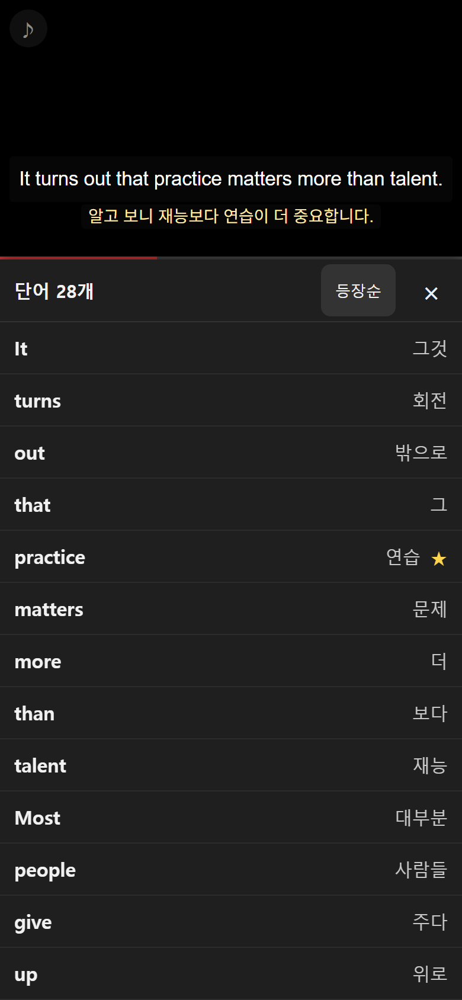
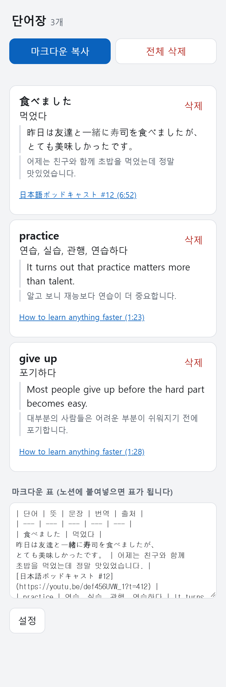

# SubAudioOnly

유튜브를 팟캐스트처럼 틀어 놓고 외국어 공부할 때 쓰려고 만든 Firefox 확장입니다. 안드로이드 Firefox 기준으로 만들었고 데스크톱에서도 돌아갑니다.

영상은 안 받고 소리만 틀어 주고, 화면에는 자막 두 줄(학습 언어 + 내 언어)만 남깁니다. 모르는 단어는 눌러서 뜻을 보고 단어장에 담아 두면 됩니다.

| 자막 | 사전 | 영상 단어 목록 | 단어장 |
| --- | --- | --- | --- |
|  |  |  |  |

## 설치

**[subaudioonly.xpi 내려받기](https://github.com/8p4dev/SubAudioOnly/releases/latest/download/subaudioonly.xpi)** (Mozilla 서명본, Firefox 125 이상)

안드로이드

1. 위 파일을 폰에 받습니다.
2. Firefox 설정 > Firefox 정보에서 로고를 다섯 번 누르면 디버그 메뉴가 켜집니다.
3. 설정으로 돌아가 "파일에서 확장 기능 설치"를 누르고 받은 파일을 고릅니다.

데스크톱은 `about:addons` 톱니바퀴 메뉴의 "파일에서 부가 기능 설치"로 넣으면 됩니다.

지난 버전은 [Releases](https://github.com/8p4dev/SubAudioOnly/releases)에 있습니다.

## 쓰는 법

유튜브 영상을 열면 플레이어 왼쪽 위에 ♪ 버튼이 생깁니다. 누르면 스위치가 펼쳐집니다.

- 소리만 / 자막 / 사전: 각각 켜고 끄기
- ≡ 단어: 이 영상 자막에 나오는 단어를 한꺼번에 보기

자막에서 단어를 누르면 뜻이 뜹니다. 단어가 이상하게 잘렸으면 팝업의 ◀ ▶ 로 범위를 늘리거나 줄일 수 있어요. 일본어처럼 띄어쓰기가 없는 언어에서 특히 쓸 일이 많습니다.

단어장은 툴바의 확장 버튼에서 열 수 있고, "마크다운 복사"를 누른 뒤 노션에 붙이면 표로 들어갑니다.

학습 언어와 내 언어는 설정에서 바꿉니다. 기본값은 영어 → 한국어.

## 알아둘 것

- 영상에 원하는 언어 자막이 없으면 유튜브 자동번역으로 채웁니다. 자막이 아예 없는 영상에서는 아무것도 안 나옵니다.
- 뜻은 Google 번역에서 가져옵니다. 누른 단어와 단어 목록의 단어가 Google로 전송됩니다. 그 밖의 설정과 단어장은 브라우저 안에만 저장됩니다.
- 단어 목록의 뜻은 문맥 없이 번역한 거라 어색한 게 섞여 있습니다. 정확한 뜻은 단어를 눌러서 확인하세요.
- 일본어 단어 묶기는 규칙 몇 개로 하는 거라 틀릴 때가 있습니다.
- 유튜브가 구조를 바꾸면 소리만 재생이나 자막이 깨질 수 있습니다. 그럴 땐 ♪에서 해당 기능만 끄고 쓰면 됩니다.

## 개발

빌드 단계도 의존성도 없습니다. `extension/` 폴더가 그대로 확장입니다.

```sh
npx web-ext run -s extension   # 데스크톱 Firefox에서 바로 실행
npm test
npm run lint
npm run build                  # dist/ 에 zip
```
